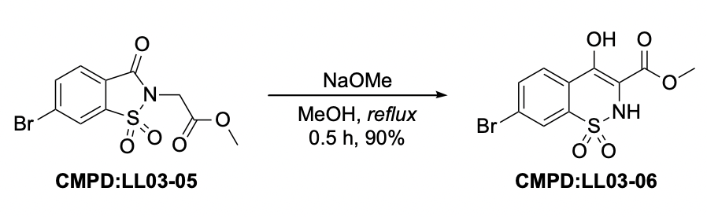
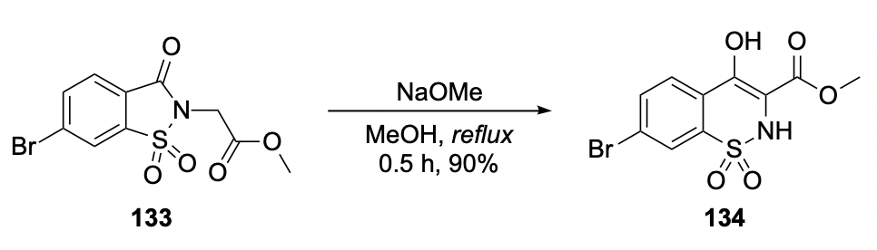
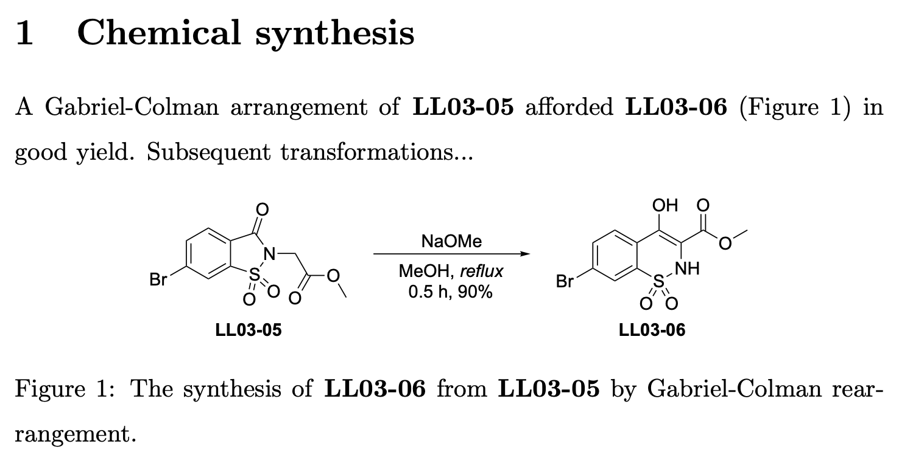
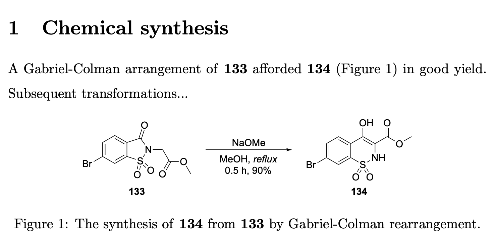

# A system for managing compound numbering

Keeping compound numbers consistent across a long chemistry document can be surprisingly difficult. If a compound is inserted or removed, every subsequent compound may need to be renumbered—not only in the text, but also across multiple ChemDraw files. A single change can therefore result in hours of tedious and error-prone manual editing.

This repository provides a simple system for avoiding that problem. It is based on the workflow I used while preparing my PhD thesis, where it allowed me to manage hundreds of numbered compounds consistently across LaTeX and ChemDraw.

The central idea is simple:

**Never refer to a compound by its final compound number in your source files. Instead, refer to it using a permanent compound ID, such as a lab-book reference.**

For example, rather than hard-coding compound **133** throughout your LaTeX document and ChemDraw files, you might use the permanent ID:

```text
LL03-05
```

A central CSV file then defines the mapping:

```text
LL03-05 -> 133
```

The system automatically converts these IDs into the appropriate compound numbers when preparing the final document.

Three components work together to keep everything synchronised:

- a Python script relabels compounds in ChemDraw `.cdxml` files;
- an AppleScript exports the relabelled ChemDraw files to PDF; and
- a LaTeX `\cmpd` command converts compound IDs into compound numbers in the text.

As a result, changing the numbering scheme only requires editing the central CSV file. If, for example, a compound is inserted and compounds 133–200 need to become 134–201, you update those values in the CSV rather than manually editing every occurrence in the thesis and every ChemDraw file.

The individual components are intentionally simple and can be adapted independently for other workflows.

## Quick start

If you already have **macOS, ChemDraw, Python 3, and TeX Live** installed, the example can be tried in a few minutes:

1. Clone or download this repository and open a terminal in its root directory.
2. Open `chemdraw/cdxml/example.cdxml` in ChemDraw. The structures are labelled with permanent IDs such as `CMPD:LL03-05`, rather than final compound numbers.
3. Open `maps/structure_id_map.csv`. This file assigns those IDs their displayed numbers.
4. Run `./compile.sh`. ChemDraw will briefly open while the generated CDXML file is exported.
5. Open `build/main.pdf` to see the numbered compounds in both the text and scheme.
6. Change a label in `maps/structure_id_map.csv`, run `./compile.sh` again, and confirm that the number changes everywhere.

The files in `chemdraw/cdxml/` are the source files and are never relabelled in place. Generated CDXML files are written to `chemdraw/cdxml_/`, and their exported PDFs are written to `chemdraw/out/`.

> [!IMPORTANT]
> Keep source `.cdxml` files directly inside `chemdraw/cdxml/`; nested directories are not currently supported. The build now stops with an error for missing mappings, duplicate compound IDs or labels, malformed IDs, or invalid mapping settings rather than silently producing inconsistent output.

## How it works

The workflow can be summarised as:

```text
                         maps/structure_id_map.csv
                                  |
                    +-------------+-------------+
                    |                           |
                    v                           v
             Python relabelling            LaTeX lookup
                    |                           |
                    v                           |
         ChemDraw source (.cdxml)               |
                    |                           |
                    v                           |
         Relabelled .cdxml files                |
                    |                           |
                    v                           |
            AppleScript export                  |
                    |                           |
                    v                           v
              ChemDraw PDFs ------------> Final LaTeX PDF
```

The CSV mapping file is therefore the **single source of truth** for compound numbering.

## 1. Define the compound-number mapping

The central mapping is stored in:

```text
maps/structure_id_map.csv
```

Each compound has a permanent ID and a corresponding display number. For example, the mapping supplied with this repository contains:

```text
LL03-05 -> 133
LL03-06 -> 134
```

The CSV also contains a `notes` column. This can contain names, descriptions, or other information that makes the mapping easier to understand:

```text
compound,label,notes
LL03-05,133,Example compound
LL03-06,134,Another example compound
```

The `notes` column is ignored by the relabelling system and exists only for human readability.

## 2. Label compounds by ID in ChemDraw

Source ChemDraw files are stored in:

```text
chemdraw/cdxml/
```

Instead of assigning compounds their final numbers directly in ChemDraw, label them using the prefix `CMPD:` followed by the permanent compound ID.

For example:

```text
CMPD:LL03-05
```

Do **not** write:

```text
133
```

The compound ID should contain only alphanumeric characters and hyphens.

For example:

```text
LL03-05    ✓
LL03_05    ✗
```

This restriction is defined by a regular expression in `scripts/relabel_cdxmls.py`. You can modify the expression if your IDs require additional characters, although this is not recommended: some characters can also cause problems when the IDs are used as arguments to commands in `.tex` files.

The text box containing the `CMPD:` tag should be **centre-aligned**. This ensures that the label remains correctly positioned when an ID such as `CMPD:LL03-05` is replaced by a much shorter number such as `133`.



## 3. Relabel the ChemDraw files

The Python script:

```text
scripts/relabel_cdxmls.py
```

reads `maps/structure_id_map.csv` and constructs a one-to-one mapping between compound IDs and compound numbers.

During this process, it:

1. reads the `compound` and `label` columns;
2. ignores the `notes` column;
3. strips surrounding whitespace from the relevant values; and
4. creates a lookup mapping from each compound ID to its label.

The script then searches for `.cdxml` files in:

```text
chemdraw/cdxml/
```

The original files are **not modified**.

Instead, the script copies them to the mirror directory:

```text
chemdraw/cdxml_/
```

and performs all relabelling on those copies.

Because CDXML is a human-readable text format, the script can search the copied files for `CMPD:` tags and replace them with the corresponding numbers.

For example:

```text
CMPD:LL03-05
```

becomes:

```text
133
```



This separation means that your source ChemDraw files always retain the permanent compound IDs, while the generated copies contain the current display numbers.

## 4. Generate the LaTeX lookup table

The Python script also generates:

```text
maps/_structure_id_map.csv
```

This is a processed version of `maps/structure_id_map.csv` containing only the columns required by LaTeX, with unnecessary whitespace removed.

The generated file is subsequently loaded during LaTeX compilation and used to translate compound IDs into compound numbers in the document text.

You should therefore edit `maps/structure_id_map.csv`, not the generated `_structure_id_map.csv`.

## 5. Export the relabelled ChemDraw files to PDF

After the `.cdxml` files have been relabelled, they need to be exported to a format that can be included in the LaTeX document.

The AppleScript:

```text
scripts/cdxml2pdf.applescript
```

automates this process.

It searches:

```text
chemdraw/cdxml_/
```

for the generated `.cdxml` files, then instructs ChemDraw to open each file and export it as a PDF with the same filename into:

```text
chemdraw/out/
```

These PDFs can then be included normally in LaTeX, for example using:

```latex
\includegraphics{...}
```

This avoids having to manually open and export every relabelled ChemDraw file whenever the numbering changes.

## 6. Refer to compounds by ID in LaTeX

The LaTeX-side functionality is defined in:

```text
relabel.tex
```

Include this file in the document preamble:

```latex
\input{relabel.tex}
```

`relabel.tex` loads the generated:

```text
maps/_structure_id_map.csv
```

and creates a lookup table named `chemmap`.

It also defines the `\cmpd` command.

Instead of writing a compound number directly:

```latex
Compound 133 was obtained...
```

write:

```latex
Compound \cmpd{LL03-05} was obtained...
```

During compilation, `\cmpd{LL03-05}` looks up `LL03-05` in `chemmap` and outputs its current compound number:

```text
133
```

If no matching compound is found, the compound ID itself is printed. This makes missing mappings easier to identify.

The important consequence is that **compound numbers are never hard-coded into the main LaTeX source**.

## Temporarily displaying compound IDs

During writing or editorial review, it can sometimes be more useful to see permanent compound IDs than final compound numbers.

Relabelling can therefore be disabled.

Changing the first line of:

```text
maps/structure_id_map.csv
```

from:

```text
RELABEL=TRUE
```

to:

```text
RELABEL=FALSE
```

disables relabelling.

Relabelling can also be controlled specifically for the main LaTeX text from `relabel.tex`. Comment out:

```latex
\relabelCmpdstrue
```

and uncomment:

```latex
\relabelCmpdsfalse
```

to display compound IDs instead of compound numbers.

For example, the original document with relabelling disabled:



can be compiled with relabelling enabled to produce:



## Running the complete workflow

The individual steps need to run in a specific order. The repository therefore provides:

```bash
./compile.sh
```

This script reproducibly runs the relabelling, ChemDraw export, and required `pdflatex` compilation passes to generate the final document.

In normal use, the workflow is therefore:

```text
1. Edit your LaTeX and source ChemDraw files using permanent compound IDs
2. Update maps/structure_id_map.csv as required
3. Run ./compile.sh
4. Obtain the final document with consistent compound numbering
```

If the numbering changes, you only need to update the mapping file and recompile.

## Avoiding unnecessary ChemDraw exports

Opening and exporting large numbers of ChemDraw files can be slow and visually distracting, particularly when a project contains tens or hundreds of files.

The system therefore avoids relabelling and exporting files that have not changed.

The last run times are cached in:

```text
chemdraw/cdxml_/.relabel_last_run_epoch
chemdraw/out/.chemDraw_last_run_epoch
```

On subsequent runs, only ChemDraw files modified after the relevant previous run are processed again. Generated CDXML and PDF files whose source file has been deleted or renamed are also removed, preventing stale figures from surviving in the output directories.

There is one important exception: if

```text
maps/structure_id_map.csv
```

has changed since the previous run, **all ChemDraw files are relabelled and re-exported**.

This is necessary because a change to the central mapping may affect the number assigned to any compound, so the system cannot safely determine which ChemDraw files remain valid.

## Performance

I used this system throughout the preparation of my PhD thesis, which contained hundreds of relabelled compounds distributed across tens of `.cdxml` files.

The Python relabelling step is very fast. Parsing the CSV and performing hundreds of replacements generally takes only a fraction of a second.

The LaTeX lookups are similarly inexpensive, adding only a small amount of compilation time even with hundreds of `\cmpd` calls.

The main performance bottleneck is the AppleScript-controlled ChemDraw export, because ChemDraw must open and export files sequentially. The modification-time caching described above substantially reduces this overhead during normal use.

## Requirements

The system currently requires:

- **Python 3** — tested with Python 3.13. The relabelling script uses only the Python standard library and should work with many other Python 3 versions.
- **macOS** — tested with macOS Tahoe 26.6.2. macOS is currently required for the AppleScript-based ChemDraw export.
- **ChemDraw** — tested with ChemDraw 26.1.0.6801 and previously used successfully with an older version.
- **TeX Live** — tested with the 2024 distribution. The LaTeX workflow requires `pdflatex` and the packages used by `relabel.tex`.

### Windows

The Python and LaTeX components should be portable, but the ChemDraw PDF export currently depends on AppleScript.

A Windows implementation would therefore need an equivalent automation mechanism, such as a PowerShell script, to control ChemDraw and export the generated `.cdxml` files.

### Overleaf

TeX Live is available in Overleaf environments, but this workflow also depends on running the Python relabelling script and, more importantly, controlling a local ChemDraw installation to export the `.cdxml` files.

I have not tested an Overleaf-based workflow. Contributions or documentation for an effective Overleaf setup would be welcome.

## Why use this system?

Without this system, inserting a compound early in a long document might require manually changing:

```text
133 -> 134
134 -> 135
135 -> 136
...
```

across both the LaTeX source and multiple ChemDraw files.

With this system, the source files continue to refer to permanent IDs:

```text
LL03-05
LL03-06
LL03-07
```

Only their mappings change:

```text
LL03-05 -> 134
LL03-06 -> 135
LL03-07 -> 136
```

The next compilation propagates those changes through both the text and ChemDraw figures.

This separates a compound's **identity** from its **display number**, making large-scale renumbering considerably safer and easier.

## Validation and tests

The relabelling step deliberately fails early when it detects an inconsistent project. It checks the mapping file for duplicate IDs and labels, empty or malformed values, and invalid `RELABEL` settings. It also checks literal `\cmpd{...}` references in the top-level LaTeX files and `CMPD:` tags in any CDXML file being processed.

The Python code uses only the standard library. Run its automated tests with:

```bash
python3 -m unittest discover -s tests -v
```

## Licence

This project is released under the MIT License. See [`LICENSE`](LICENSE).

## Contributions

Suggestions and improvements are welcome.

In particular, contributions would be useful for:

- support for Windows or Linux;
- alternative ChemDraw automation approaches;
- improved Overleaf integration;
- additional validation and error handling; or
- improvements to the build workflow.

If you adapt the system to another platform or workflow, please feel free to open a pull request.
